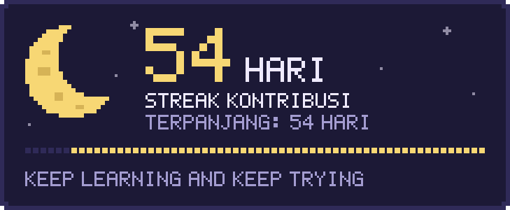

# Haii, saya Bagaskara Amukti Palapa

Mahasiswa Teknik Informatika di Universitas Bina Darma, Palembang. Saya aktif ikut lomba CTF dan lagi mendalami defensive security, terutama threat detection. Di luar itu saya bikin aplikasi web pakai JavaScript, TypeScript, Vue.js, dan Laravel, dan sesekali eksperimen LLM lokal dengan Ollama dan RAG.

Di internet saya juga pakai nama Mooncrust: [mooncrust.my.id](https://mooncrust.my.id/)

## Prestasi

- Juara 2 LKS Cyber Security tingkat Provinsi Sumatera Selatan (2025)
- Juara 2 Nusantara Cyber Security tingkat Provinsi Sumatera Selatan (2026)
- Juara 3 IT Festival Cyber Security, Politeknik Negeri Sriwijaya (2026)

## Proyek

- **[Dang Lupa ko Komering](https://github.com/BagaskaraAP-Dev/danglupakokomering)**: portal budaya Suku Komering untuk lomba Vibe Coding IT Festival 2026. Ada penerjemah Indonesia ke Basa Kumoring (dan sebaliknya) dengan kamus 3.739 kata. [Buka situsnya](https://danglupakokomering.mooncrust.my.id)
- **[AeroSense](https://github.com/BagaskaraAP-Dev/aerosense)**: pemantau kualitas udara Palembang. Menampilkan AQI saat ini, prakiraan 24 jam, dan cek pemakaian masker lewat kamera yang diproses langsung di HP. [Coba di sini](https://aerosense-pied.vercel.app)
- **[Kostan](https://github.com/BagaskaraAP-Dev/kostan-bagaskaraap-dev)**: aplikasi reservasi kamar kost dengan Node.js, Express, dan SQLite. Panel admin untuk verifikasi pembayaran dan menangani laporan kerusakan fasilitas.
- **[mooncrust-cli](https://github.com/BagaskaraAP-Dev/mooncrust-cli)**: CLI untuk Mooncrust AI, tersedia sebagai binary Linux dan Windows.
- **BDCA Learn** (repo privat): platform belajar untuk Bidar Cyber Army, berisi latihan Excel, terminal Linux, dan cybersecurity.

## Writeup CTF

- [picoCTF](https://github.com/BagaskaraAP-Dev/Writeup-PicoCTF-Bagaskara-Amukti-Palapa): 10 soal level Hard, dari web, binary exploitation, reverse engineering, sampai forensics
- [TechtonicExpo CTF 2026](https://github.com/BagaskaraAP-Dev/Writeup-Techtonic-CTF-2026): crypto, forensics, pwn, dan web
- [Cyber Frontier 2026 — Beyond the Attack](https://github.com/BagaskaraAP-Dev/cyber-frontier-2026-beyond-the-attack): 15 soal, dari web, reverse engineering, crypto, forensics, network, misc, sampai OSINT
- [CTF POLSRI 2026](https://github.com/BagaskaraAP-Dev/ctf-polsri-2026): web exploitation
- [Mooncrust — Deep Space Recon](https://github.com/BagaskaraAP-Dev/mooncrust-deep-space-recon): recon dan skrip solver
- [BDCA — Gubernur Helikopter](https://github.com/BagaskaraAP-Dev/bdca-gubernur-helikopter): seri challenge Chapter 1–5
- [Martabak Manis](https://github.com/BagaskaraAP-Dev/martabak-manis): writeup tim
- [IT Festival 2026 (MMC)](https://github.com/BagaskaraAP-Dev/festi-2026-mmc): writeup tim MMC

## Sertifikat

- White-hat Hacker Essentials
- Blue Team Fundamentals
- Fundamental Front-End Web Development
- Pelatihan Vibe Coding, Politeknik Negeri Sriwijaya (2026)

## Pendidikan

- S1 Teknik Informatika, Universitas Bina Darma (sedang berjalan)
- SMK Muhammadiyah 03 Sukaraja, lulus 2025

---

Kontak: [karabagas580@gmail.com](mailto:karabagas580@gmail.com)
