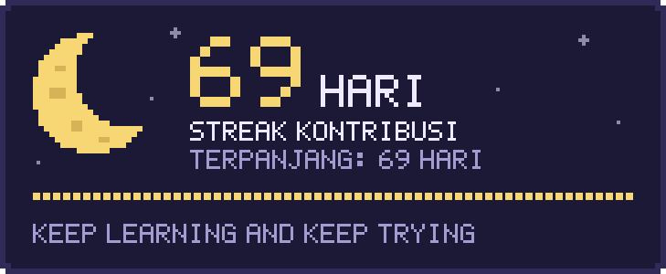

# Hai, saya Bagaskara Amukti Palapa

Mahasiswa Teknik Informatika di Universitas Bina Darma, Palembang, asal Kurungan Nyawa, Buay Madang, OKU Timur, Sumatera Selatan. Saya aktif ikut lomba CTF dan lagi mendalami defensive security, terutama threat detection. Di luar itu saya full stack developer: bikin aplikasi web pakai JavaScript, TypeScript, Vue.js, Laravel, dan PHP, dan sesekali eksperimen LLM lokal dengan Ollama dan RAG.

Di internet saya juga pakai nama Mooncrust: [mooncrust.my.id](https://mooncrust.my.id/). Profil lengkap saya ada di [mooncrust.my.id/bagaskara](https://mooncrust.my.id/bagaskara).

## Prestasi

- Juara 2 Vibe Coding, IT Festival 2026 Politeknik Negeri Sriwijaya
- Juara 2 Nusantara Cyber Security (APTIKOM) tingkat Provinsi Sumatera Selatan (2026)
- Juara 3 Cyber Security, IT Festival 2026 Politeknik Negeri Sriwijaya
- Juara 2 LKS Cyber Security tingkat Provinsi Sumatera Selatan (2025)

## Proyek

- **[Mooncrust](https://mooncrust.my.id/)**: asisten AI berbahasa Indonesia yang saya bangun sendiri dari antarmuka sampai backend. Bisa membaca foto, video, dan PDF, punya login Google, chat yang bisa dibagikan lewat link, dan bot Discord.
- **[Dang Lupa ko Komering](https://github.com/BagaskaraAP-Dev/danglupakokomering)**: portal budaya Suku Komering untuk lomba Vibe Coding IT Festival 2026. Ada penerjemah Indonesia ke Basa Kumoring (dan sebaliknya) dengan kamus 3.739 kata. [Buka situsnya](https://danglupakokomering.mooncrust.my.id)
- **[AeroSense](https://github.com/BagaskaraAP-Dev/aerosense)**: pemantau kualitas udara Palembang. Menampilkan AQI saat ini, prakiraan 24 jam, dan cek pemakaian masker lewat kamera yang diproses langsung di HP. [Coba di sini](https://aerosense-pied.vercel.app)
- **[Adventure MNC](https://adventuremnc.mooncrust.my.id)**: game petualangan 3D dunia terbuka berlatar Kutub Selatan Bulan.
- **[segtrack](https://github.com/BagaskaraAP-Dev/yolov8-seg-tracking)**: segmentasi instance dan pelacakan banyak objek di video, ditulis ulang dari demo DeepSORT milik Muhammad Moin Faisal ke API ultralytics terbaru, lengkap dengan pengujian.
- **[Kostan](https://github.com/BagaskaraAP-Dev/kostan-bagaskaraap-dev)**: aplikasi reservasi kamar kost dengan Node.js, Express, dan SQLite. Panel admin untuk verifikasi pembayaran dan menangani laporan kerusakan fasilitas. [Demo](https://bagaskaraap-dev.github.io/kostan-bagaskaraap-dev/)
- **[Gia's Patisserie](https://github.com/BagaskaraAP-Dev/tokogia)**: aplikasi PWA untuk mencatat keuangan harian toko kue, sekaligus buku resep.
- **[RS Bagas](https://github.com/BagaskaraAP-Dev/rumahsakitbagas)**: website konsep rumah sakit dengan gedung 3D interaktif (Next.js, React, Three.js).
- **[3D Laycard Universitas Bina Darma](https://github.com/BagaskaraAP-Dev/3d-laycard-binadarma)**: kartu identitas 3D pada tali lanyard dengan simulasi fisika. [Demo](https://bagaskaraap-dev.github.io/3d-laycard-binadarma/)
- **[InvisibleToggle](https://github.com/BagaskaraAP-Dev/projectpython_BagaskaraAP2026)**: efek jubah tak terlihat lewat webcam dengan Python, OpenCV, dan MediaPipe.
- **[Lab PHP 8.3 dan Docker Compose](https://github.com/BagaskaraAP-Dev/belajarmasterbrief)**: lab belajar backend dengan Nginx, PostgreSQL 16, dan Redis 7.
- **[mooncrust-cli](https://github.com/BagaskaraAP-Dev/mooncrust-cli)**: CLI untuk Mooncrust AI, tersedia sebagai binary Linux dan Windows.
- **BDCA Learn** (repo privat): platform belajar untuk Bidar Cyber Army, berisi latihan Excel, terminal Linux, dan cybersecurity.

## Writeup CTF

- [Nusantara Cyber Security 2026](https://github.com/BagaskaraAP-Dev/writeup-ncs-2026): writeup tim Universitas Bina Darma, Juara 2 tingkat Provinsi Sumatera Selatan
- [TryHards CTF 2026](https://github.com/BagaskaraAP-Dev/writeup-tryhards-ctf-2026): writeup Tim Ruy oleh Mooncrust (Reverse Engineering, Forensics/Network, Cryptography/Video Stego, dan analisis partial solve)
- [hiCTF 2026: Hidden Investigations CyberCon](https://github.com/BagaskaraAP-Dev/Writeup-hiCTF-2026-Bagaskara-Amukti-Palapa): 7 soal, dari cryptography, reverse engineering, steganography, sampai android, lengkap dengan diagram alur solusi
- [picoCTF](https://github.com/BagaskaraAP-Dev/Writeup-PicoCTF-Bagaskara-Amukti-Palapa): 10 soal level Hard, dari web, binary exploitation, reverse engineering, sampai forensics
- [TechtonicExpo CTF 2026](https://github.com/BagaskaraAP-Dev/Writeup-Techtonic-CTF-2026): crypto, forensics, pwn, dan web
- [Cyber Frontier 2026: Beyond the Attack](https://github.com/BagaskaraAP-Dev/cyber-frontier-2026-beyond-the-attack): 15 soal, dari web, reverse engineering, crypto, forensics, network, misc, sampai OSINT
- [CTF POLSRI 2026](https://github.com/BagaskaraAP-Dev/ctf-polsri-2026): web exploitation
- [Mooncrust: Deep Space Recon](https://github.com/BagaskaraAP-Dev/mooncrust-deep-space-recon): recon dan skrip solver
- [BDCA: Gubernur Helikopter](https://github.com/BagaskaraAP-Dev/bdca-gubernur-helikopter): seri challenge Chapter 1 sampai 5
- [Martabak Manis](https://github.com/BagaskaraAP-Dev/martabak-manis): writeup tim
- [IT Festival 2026 (MMC)](https://github.com/BagaskaraAP-Dev/festi-2026-mmc): writeup tim MMC
- [FGTE 2025](https://github.com/BagaskaraAP-Dev/Writeup-FGTE-2025-Bagaskara-Amukti-Palapa): 5 soal, dari forensics, misc, reverse engineering, sampai web

## Sertifikat

- White-hat Hacker Essentials
- Blue Team Fundamentals
- Fundamental Front-End Web Development
- Pelatihan Vibe Coding, Politeknik Negeri Sriwijaya (2026)

## Pendidikan

- S1 Teknik Informatika, Universitas Bina Darma (sedang berjalan)
- SMK Muhammadiyah 03 Sukaraja, lulus 2025

---

Kontak: [karabagas580@gmail.com](mailto:karabagas580@gmail.com)
